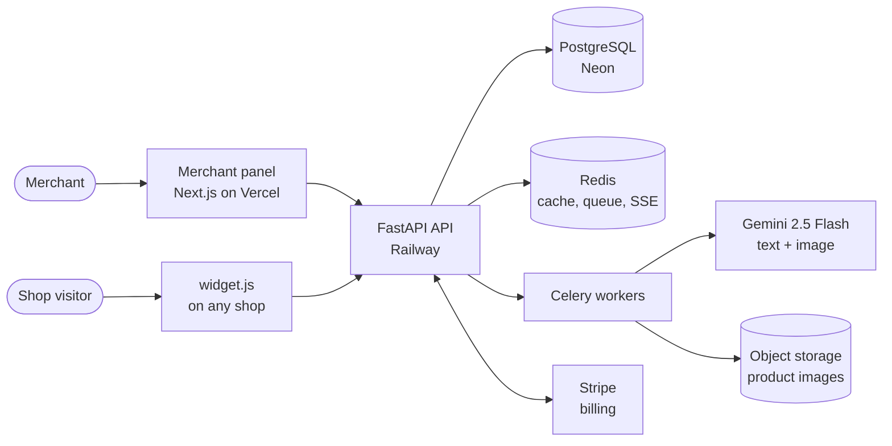

# Dynamic Filters

AI-generated product filters for online shops. A merchant connects a product feed, Gemini reads each product (text and image) and turns it into structured attributes, and one script tag adds a filter panel to any storefront.

**Status:** pre-launch (founder phase, no customers yet) · built solo · [Website](https://filters.itntoit.dev) · [Live demo shop](https://demo.itntoit.dev)

> The source code is private. This repository is a showcase: architecture, key engineering decisions and selected code. I am happy to walk through the full code in an interview.

<!-- TODO Jacek: add demo.gif (30–60 s: feed import → AI tagging progress → filters on the demo shop) -->
<!--  -->

## Architecture

## Engineering highlights

### 1. Asynchronous AI pipeline
- Feed import: Google Shopping XML, CSV or JSON, with an XXE-safe XML parser and an SSRF guard on feed URLs.
- Celery workers send products in chunks of 30 to Gemini 2.5 Flash (multimodal) and get structured attributes back, for example colour, power or material.
- Live progress for the merchant through Redis pub/sub and server-sent events.
- **What went wrong:** a task took 300 products, made 10 Gemini calls, ran about 600 s and was killed by the worker time limit. Fix: 90-product tasks, chained until the catalogue is done.

### 2. GDPR by design
A daily inactivity lifecycle in 5 stages:

| Stage | When (days inactive) | What happens |
|---|---|---|
| 1–3 | 300, 365, 388 | Warning e-mails, with a "keep my account" link |
| 4 | 395 | PII anonymisation, Stripe subscription cancelled, shop deactivated |
| 5 | 575 | Hard delete, including product images in object storage |

- Active subscribers are excluded from every stage.
- The Stripe customer id is kept for the 5-year VAT retention.
- Each stage is isolated: a failure in one stage does not stop the next. Stage 4 commits per user.
- The cron is monitored with Sentry check-ins.
- Code: [`samples/anonymization_service.py`](samples/anonymization_service.py)

### 3. Embeddable widget
- `widget.js`: vanilla JavaScript, no dependencies, added with one `<script>` tag.
- Filtering runs in the visitor's browser. Configuration, filters and product tags come from the API, cached in Redis.
- Served only for shops with an active subscription.

### 4. Quality and security gates on every pull request
- About 1,560 backend tests and 75 frontend test files.
- Playwright + axe (accessibility) end-to-end tests against a live stack; Stryker mutation report.
- Lockfile freshness check, `pip-audit`, `osv-scanner`, `audit-ci`, `gitleaks`, `bandit`, and a blocking Trivy scan of the Docker image.

### 5. Pre-launch audits
A chain of audits before the first customer: security, architecture, performance, test quality, infrastructure and launch readiness. A business-logic audit of the subscription and freemium model: 71 of 72 findings fixed.

## Stack

| Layer | Technology |
|---|---|
| Backend | Python 3.12, FastAPI, SQLAlchemy 2 (async), Alembic, Celery |
| Data | PostgreSQL (Neon), Redis, S3-compatible object storage |
| Frontend | Next.js 15, React 19, TypeScript, Tailwind CSS |
| AI | Google Gemini 2.5 Flash (multimodal) |
| Billing and ops | Stripe, Sentry, Railway, Vercel, GitHub Actions |

**In numbers:** 50 API endpoints · 46 database migrations · ~1,560 backend tests.
